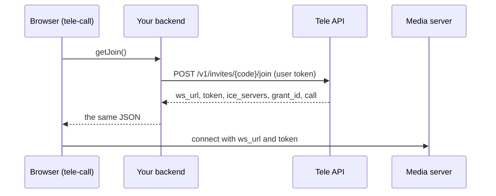

# Tele UI Pack

`<tele-call>` is a complete call screen for [Tele](https://tele.cloudguys.io/) in one web component. Put it on a page, give it a way to get the join details, and people can join a call.

- **Lobby** with camera preview and microphone, speaker and camera pickers
- **Video tiles** in a grid or with the active speaker large
- **Screen share**, **chat** with saved history, and a **recording banner**
- **Host controls** for recording and ending the call for everyone
- **Reconnect handling** and clear messages when a call ends
- **English and Bangla**, with any label overridable
- **Theming** through CSS variables and `::part()` hooks
- **React wrapper** that is safe with server rendering

## How it fits

The element adds **no new authentication**. Your backend already signs Tele user tokens and calls the join endpoint; the element only receives the join response. It never sees your API key or secret.

## Packages

| Import | What it is |
|---|---|
| `@tele/call-ui` | Registers `<tele-call>` and exports its types. ESM; `livekit-client` is a peer dependency |
| `@tele/call-ui/react` | `<TeleCall>`, a React wrapper |
| `dist/tele-call.iife.js` | One file for a `<script>` tag, with everything bundled |

## Next steps

1. [Getting started](getting-started.md): install the package and show your first call.
2. [Your backend](backend.md): the one endpoint you need to add.
3. [Reference](reference.md): every attribute, property, event and method.

The Tele API itself (calls, invites, webhooks, recordings) is documented in the [Tele developer guide](https://tele.cloudguys.io/docs/).
